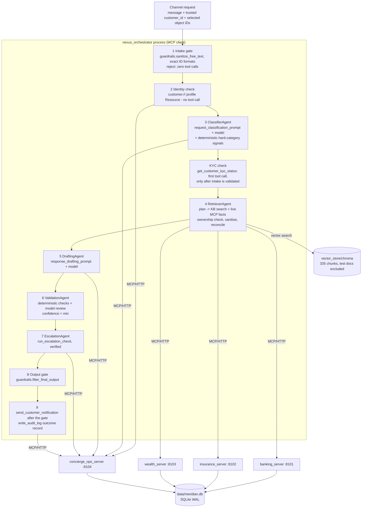

# Nexus architecture

Nexus is a single front door for Meridian Financial Group: one customer request passes through
structured intake, hybrid retrieval, five agent roles and four MCP servers in a single call path.
Requirements source: the assignment PDF (v1.0, 2026-10-05). Public MCP contract: [`MCP_CONTRACTS.md`](../MCP_CONTRACTS.md).

## 1. Data flow

ASCII equivalent: `request -> intake gate -> identity (customer:// Resource) -> Classifier -> KYC tool -> Retriever (KB + MCP) ->
Drafter -> Validator -> Escalation (MCP) -> output gate -> notify + audit (MCP)`. Any failure exits
the chain with a typed `FinalResponse` (`rejected`, `blocked`, `failed` or `escalated`), never a crash
and never a guessed answer.

## 2. Components and ownership

| Layer | Code | Responsibility |
| --- | --- | --- |
| Structured intake | `app/intake/gate.py`, `app/intake/signals.py`, `app/models/intake.py`, `app/agents/classifier_agent.py` | Validate before anything else; server-generated `request_id`; exact `CUS-XXXXX`; intake-time `escalation_category` |
| Hybrid retrieval | `app/retrieval/retrieval.py` (dense + BM25 + RRF + MMR + rerank + quality gate), `adapter.py`, `planner.py`, `hybrid.py`, `reconcile.py`, `app/knowledge_base.py` | KB guidance + live MCP facts -> `GroundedContext`; conflicts in code, MCP authoritative |
| Agent roles | `app/agents/*_agent.py`, `app/agents/llm.py` (CrewAI), `app/agents/scripted.py` (deterministic test/demo backend) | Five distinct roles, injected model + gateway |
| Orchestration | `nexus_orchestrator.py` | Explicit controller, typed failures, HTTP API, CLI |
| MCP client | `app/mcp_client/gateway.py` (interface + call records), `http_gateway.py` (production), `in_process.py` (demo/tests only) | All backend access; allowlist of tool -> server |
| MCP servers | `mcp_servers/{banking,insurance,wealth,concierge_ops}_server.py`, `mcp_servers/common.py` | 13 Tools, 4 Resources, 2 Prompts |
| Data access | `app/db_access.py`, `database.py`, `db/schema.sql`, `db/seed_data.py` | Least-privilege SQLite, seeding with backup |
| Guardrails | `app/guardrails.py` | Sanitisation, injection defence, masking, minimisation, log redaction, output filter |
| Observability | `app/logging_config.py` | `@trace(logger)` JSON ENTER/EXIT/FAILED, request-ID context |

**Resources and Prompts ownership.** `account://` lives on banking and `policy://` on insurance (each
reads only its own table). `customer://` lives on concierge_ops, the only server allowed to read
`customers`. `knowledgebase://` and both Prompts also live on concierge_ops: they serve customer
communication and orchestration, not a product domain, and the KB Resource reads local files, not
another server's tables.

**Where Resources and Prompts are used in the live path.** The identity step reads
`customer://{id}/profile` (tier, first name, prior interaction for the classifier). Because it is a
Resource and not a Tool, no tool runs until the intake schema is validated (PDF 3.2); the first tool
call is `get_customer_kyc_status`, after classification. The profile carries no KYC data - that tool is
the only source of raw KYC data (PDF 3.1). The Classifier
fetches `request_classification_prompt` and the Drafter fetches `response_drafting_prompt` from MCP.
`account://`, `policy://` and `knowledgebase://` are available to MCP clients such as Claude
Desktop; they are exercised by `tests/test_mcp_registration.py`, `tests/test_live_processes.py` and
`scripts/verify_live.py`.

## 3. Pipeline decisions

| Situation | Outcome | Sendable |
| --- | --- | --- |
| Malformed/missing/conflicting ID, caller-set pipeline field, oversized or empty text | `rejected`, typed `IntakeError`, zero tool calls | no |
| Injection signature in customer text | `blocked` (`prompt_injection`), zero tool calls | no |
| Well-formed but unknown customer | `rejected` (`unknown_customer`) after one `customer://` Resource read - zero tool calls | no |
| Model extraction invalid/incomplete | `rejected` (`incomplete_extraction`), no retrieval, no domain call | no |
| Referenced record owned by someone else | `failed` (`ownership_mismatch`) | no |
| Required MCP server down / error envelope | `failed` (`service_unavailable` / `mcp_tool_error`), no draft, escalation still requested | no |
| Required reference missing or KB insufficient | `escalated` (server says `low_confidence` at 0.0) | no |
| Hard category (any wording) | `escalated` (`hard_category`), holding reply only | no |
| Validation confidence < 0.70 | `escalated` (`low_confidence`) | no |
| Validation failed | `escalated` (`validation_failure` or `low_confidence`) - rejected draft never delivered | no |
| Output gate: unmasked ID, contact details, injection text, claimed action | `blocked` (`output_blocked`) | no |
| Output gate: unproven numbers, missing/unknown citations, guarantees | `escalated` | no |
| Delivery refused by KYC rule | `escalated` (`manual_review_required`) | no |
| Everything passes | `ready`; notification `logged` (never claimed delivered) | yes |

Block vs escalate: **block** when the text itself is unsafe to show (identifiers, contact details,
injection residue, a false claim that something was done); **escalate** when the text may be fine but
is not proven (validation failure, unsupported or unverifiable claims, low confidence, hard category).

Confidence is computed by the Validation Agent as `min(deterministic cap, model review)`. Deterministic
caps include unknown citations (0.4), contradicting a live fact (0.2), numbers not in evidence (0.4),
an inconclusive decisive check such as `no_matching_clause` (0.55) and KB found only after query
expansion (0.65). A model can lower confidence but never raise it above the caps.

## 4. Requirement -> code -> test -> evidence matrix

Tests are in `tests/`; "demo" refers to sections of `python run_local_demo.py`; "live" to
[`docs/evidence/live_verification.md`](evidence/live_verification.md).

| PDF requirement | Owning code | Tests | Demo / live evidence |
| --- | --- | --- | --- |
| 2: plain local processes, `database.py --seed`, `build_index.py` | `database.py`, `build_index.py`, `mcp_servers/*`, `nexus_orchestrator.py` | `test_database.py::test_seed_*`, `test_live_processes.py` | live section 1 |
| 3: four connected layers in one call path | `nexus_orchestrator.py` | `test_orchestrator.py::test_arjun_showcase_flows_through_all_layers` | demo 3, 7; live section 3 |
| 3: structural table isolation | `app/db_access.py`, `mcp_servers/common.py` | `test_database.py::test_each_server_is_structurally_unable_to_read_foreign_tables`, `test_joins_through_foreign_tables_are_denied`, `test_read_only_servers_cannot_write`, `test_concierge_writes_only_its_write_tables_and_never_customers` | - |
| 3: no direct backend access outside MCP | `app/mcp_client/*` | `test_architecture.py::test_orchestration_layers_never_touch_sqlite_or_server_code`, `test_only_mcp_servers_use_scoped_database_access`, `test_production_wiring_does_not_use_in_process_adapters` | live MCP call lists |
| 3.1: 13 tools, names, two write tools | `mcp_servers/*_server.py` | `test_mcp_registration.py::test_exactly_13_tools_4_resources_2_prompts`, `test_published_signatures_match_the_contract`, `test_mcp_tools.py` (62 cases) | live section 2 |
| 3.2: typed intake before anything; server request_id; CUS format; enums; sanitised intent; intake-time category | `app/intake/*`, `app/models/intake.py`, `classifier_agent.py` | `test_intake.py` (44 cases), `test_orchestrator.py::test_stress_missing_customer_id` | demo 1; live "invalid intake" |
| 3.2: invalid extraction does not proceed | `classifier_agent.py` | `test_intake.py::test_invalid_or_incomplete_extraction_is_a_typed_rejection`, `test_model_failure_is_a_typed_rejection` | demo 1 (incomplete extraction) |
| 3.3: KB + structured retrieval reconciled; MCP authoritative; conflict surfaced to validation | `app/retrieval/hybrid.py`, `reconcile.py`, `validation_agent.py` | `test_retrieval.py::test_agreement_*`, `test_policy_permits_but_account_restricted_conflict_is_explicit`, `test_agents.py::test_validation_requires_conflicts_to_be_respected`, `test_orchestrator.py::test_stress_retrieval_conflict` | demo 2, 8b; live conflict |
| 3.4: five distinct roles; confidence + hard escalation | `app/agents/*`, `nexus_orchestrator.py` | `test_orchestrator.py` (role order asserted), `test_agents.py` | demo 3-5 |
| 3.4/4: hard rule in `run_escalation_check`, unbypassable by rephrasing | `concierge_ops_server.run_escalation_check`, `app/intake/signals.py`, `escalation_agent.py` | `test_mcp_tools.py::test_hard_categories_always_escalate` (18), `test_intake.py::test_hard_category_signals_survive_rephrasing`, `test_deterministic_signals_override_an_unsafe_model_classification`, `test_agents.py::test_decision_that_violates_hard_rule_is_rejected` | demo 5, 8c; live hard escalation |
| 4: scoped field visibility, explicit caller_scope | `guardrails.minimize_account_fields` / `minimize_portfolio_fields`, servers | `test_guardrails.py::test_account_minimization_by_scope`, `test_unsupported_scope_is_rejected_not_defaulted`, `test_mcp_registration.py::test_banking_and_wealth_tools_publish_required_caller_scope`, `test_mcp_tools.py::test_internal_scope_requires_documented_trust_flag` | live "internal_service refused" |
| 4: mask account/policy/portfolio numbers on every Tool and Resource | `guardrails.mask_identifier`, servers | `test_mcp_tools.py::assert_masked` usages, `test_mcp_registration.py::test_resources_return_narrow_masked_data` | live section 2 |
| 4: exact ID formats with typed errors | `guardrails.ID_FORMATS`, `mcp_servers/common.id_error` | `test_guardrails.py::test_exact_identifier_formats`, `test_database.py::test_all_seeded_identifiers_use_the_exact_formats` | - |
| 4: audit log on writes | `concierge_ops_server`, `nexus_orchestrator._audit` | `test_mcp_tools.py::test_send_customer_notification_logs_and_audits_atomically`, `..._rolls_back_when_audit_fails`, `test_write_audit_log*`, `test_orchestrator.py` (audit row asserted) | - |
| 4: sanitise customer text, retrieved docs, tool output, outbound messages | `guardrails.sanitize_free_text`; used in `gate.py`, `hybrid.py`, `reconcile.py`, servers | `test_guardrails.py::test_injection_*`, `test_retrieval.py::test_kb_document_injection_is_blocked_before_any_model`, `test_injection_inside_mcp_text_field_is_withheld`, `test_mcp_tools.py::test_send_customer_notification_validation` | demo 6 |
| 4: output filtering | `guardrails.filter_final_output`, `validation_agent.py` | `test_guardrails.py::test_output_filter_*`, `test_orchestrator.py::test_output_gate_block_path_when_validation_passes`, `test_final_gate_blocks_unsafe_text_even_if_validation_is_fooled` | - |
| 4: PII redaction in logs | `guardrails.redact_for_logging` | `test_logging_config.py::test_pii_never_reaches_arguments_or_previews`, `test_orchestrator.py::test_request_id_correlates_logs_without_raw_pii` | demo log audit; live section 6 |
| 5: @trace everywhere, JSON lines, ENTER/EXIT/FAILED, call_id, DEBUG default | `app/logging_config.py` | `test_logging_config.py`, `test_architecture.py::test_every_project_function_is_traced` | demo log audit (33k lines, call IDs matched) |
| 6: real FastMCP registration | servers | `test_mcp_registration.py` (in-memory MCP client, real package) | live section 2 |
| 6: all processes start and respond to a live client | `tests/test_live_processes.py`, `scripts/verify_live.py` | `test_each_server_process_lists_its_primitives`, `test_orchestrator_process_starts_and_reaches_all_servers` | live sections 1-3 |
| 6: Arjun showcase | fixtures `db/seed_data.py` | `test_orchestrator.py::test_arjun_showcase_flows_through_all_layers` | demo 7; live showcase |
| 6/8.2: four stress tests | orchestrator + retrieval | `test_orchestrator.py::test_stress_*`, `test_live_processes.py::test_insurance_process_stopped_mid_request` | demo 8a-8d; live sections 3-4 |
| 7: 4 Resources, 2 Prompts, templated, 3+ dynamic args, guardrails reused | `concierge_ops_server.py`, `banking_server.py`, `insurance_server.py` | `test_mcp_registration.py::test_resources_*`, `test_prompts_*` | live section 2 |
| 8: demo without a live MCP client | `run_local_demo.py`, `app/mcp_client/in_process.py`, `app/agents/scripted.py` | - | `python run_local_demo.py` (43 checks) |

## 5. Security model

- **Untrusted inputs**: customer text, every KB chunk, every MCP text field (payment terms, product
  descriptions, interaction summaries, transaction descriptions), Prompt arguments and outbound
  notification bodies all pass `sanitize_free_text`. Retrieved content that fails is withheld from every
  model and listed in `blocked_sources`; the answer is built from the remaining evidence or, if a
  required fact was withheld, the request is not answered.
- **Injection signatures** target imperative attempts (ignore previous instructions, reveal system
  prompt/secrets, role override, injected instruction blocks, chat markup, jailbreak markers, disabling
  safety controls, tool-invocation requests). They are checked against all 64 KB documents so descriptive
  policy prose is not flagged (`test_injection_in_retrieved_chunk_is_detected_but_policy_prose_is_not`).
- **Grounding** is checked, not trusted: asserted facts are compared with live values, citations must
  exist, numbers must appear in evidence, and conflicts must be respected. The model reviewer can only
  lower confidence.
- **Data minimisation**: domain servers cannot read the `customers` table; agent-scope reads omit
  balances; Resources mask customer IDs; models see identifier-masked text; audit details never contain
  the message; logs contain no customer content (see section 7).
- **Trust boundary**: servers bind to loopback and have no caller authentication. That is acceptable only
  for the local demo; `internal_service` is therefore refused unless explicitly trusted by the operator.
- **TLS**: outbound calls (OpenAI) verify certificates against the OS trust store via `truststore`
  (`app/runtime.py`), so TLS-inspecting corporate proxies work without disabling verification.
- **Telemetry**: CrewAI/OpenTelemetry telemetry is disabled in `app/runtime.bootstrap()`.

## 6. Contract tensions and how they were resolved

| Tension | Resolution |
| --- | --- |
| Tool names in the earlier contract differed from PDF 3.1 | Renamed to the PDF names; no aliases (keeps exactly 13 tools). Clients, tests, docs updated. |
| PDF 3.1 shows `caller_scope` on two tools; section 4 says every banking/wealth call | Applied the stronger rule: `caller_scope` required on all six banking/wealth tools. Unsupported scopes are rejected, never defaulted. `internal_service` needs an explicit operator trust flag. |
| `run_escalation_check` is listed as Read, but the old implementation inserted `escalation_flags` + audit rows | Made it read-only (PDF names only two write tools). The orchestrator persists every pipeline outcome, including each escalation decision and its `decision_id`, through `write_audit_log` (`action_type = nexus_request_outcome`), which is the record a human reviewer picks up. `escalation_flags` remains as seeded history; no tool writes it. No instructor override requiring flag persistence was supplied. |
| "Missing/unknown customer: no downstream retrieval or tool call" and "validated ... before ... any tool call" | A missing or malformed ID is rejected at intake with **zero** MCP calls. A well-formed ID cannot be proven to exist without a backend lookup, so the identity step reads the narrow `customer://{id}/profile` **Resource** (not a Tool); on `not_found` the request ends with a typed `unknown_customer` error and **zero tool calls** - no retrieval, drafting, domain or audit call. The first tool (`get_customer_kyc_status`) runs only after the intake schema is validated. Existence is never hard-coded and SQLite is never read directly. |
| `get_claim_status(claim_id)` has no customer argument, so ownership could not be checked | It returns the owning `customer_id` (from the `policies` join inside the insurance scope). Ownership is never inferred from masked-number suffixes. |
| Product IDs `PROD-001` did not match `PROD-XX-XX` | Migrated to type-coded IDs (`PROD-MF-01`, `PROD-ET-02`, ...) in seed data and KB documents; KB product files renamed. |
| PDF: Arjun holds a *savings* account and a *general insurance* policy; seed/KB said checking/health | Seed corrected (`POL-IN-30091` general; interaction text says savings). |
| KB documents embedded copies of customer records (full IDs, stale facts) | Removed the customer-record appendices: the KB states rules, MCP states customer facts. Prevents stale contradictions and unmasked IDs leaking through retrieval or the KB Resource. Index rebuilt (64 docs, 335 vectors). |
| Domain servers could read `customers` (PII) | Removed: only concierge_ops reads `customers` (PDF table scopes). |
| PDF 2.3 shows `python -m banking_server` and an MCP host config pointing at the servers | Root-level entry points (`banking_server.py`, ...) run the servers in `mcp_servers/`; `NEXUS_MCP_TRANSPORT=stdio` lets a host such as Claude Desktop launch them (`docs/claude_desktop_config.example.json`). The orchestrator uses its own FastMCP client over HTTP. |
| `write_audit_log` "for every write operation" | Both writes are audited: `send_customer_notification` writes its audit row in the same transaction (shared `audit_insert`), and the orchestrator's `write_audit_log` outcome record links that `notification_audit_id`. |
| Showcase answer would need "setting up" auto-debit, but no setup tool exists | The answer explains eligibility, payment terms and the authorisation next step; claiming set-up is blocked by the output gate. |

## 7. Logging and data minimisation

`@trace(logger)` (in `app/logging_config.py`) wraps every project function (enforced by
`test_architecture.py`, with a short justified exemption list: the tracer and redactors themselves,
generator context managers, abstract stubs, exception constructors and per-chunk retrieval arithmetic).
Each call emits ENTER/EXIT (DEBUG) or FAILED (ERROR, exception type + redacted traceback, then re-raise)
as one JSON object per line, sharing a `call_id`, with the request ID attached from a context variable
and propagated to servers in the `X-Nexus-Request-Id` header. `LOG_LEVEL` defaults to DEBUG; logs go to
stderr or `NEXUS_LOG_FILE`.

`redact_for_logging` supports data minimisation by design, not by convention: ID-named keys are masked;
content keys (messages, descriptions, summaries, prompts, values, queries) become length markers; any
other string longer than 64 characters is treated as content; Pydantic `input_value=` echoes are removed
from exception text; functions that return content are traced with `redact_result=True`. Logs therefore
prove what happened, in what order and how long it took, without retaining customer data. The demo and
the live run scan every log line for raw identifiers, names, contact details, customer messages and
injected text.

## 8. Configuration and assumptions

See [`.env.example`](../.env.example). Defaults: DB `data/meridian.db`, index `vector_store/chroma`,
ports 8101-8104 (servers) and 8100 (orchestrator), model `gpt-4o-mini`, embeddings
`text-embedding-3-small` (checked against `vector_store/manifest.json`). Channel authentication is
assumed to happen upstream: the `customer_id` and selected object IDs arrive as trusted metadata.

## 9. Known limitations

- Model output varies between runs. Safety properties are enforced deterministically, but the routing of
  a borderline case can differ: in two live runs the restricted-account conflict was once `ready` (the
  draft followed the live record) and once `escalated` (the draft did not state the authoritative value
  explicitly enough). Both are safe; neither claims auto-debit is available.
- `send_customer_notification` records and audits but has no delivery provider, so outcomes are always
  `logged`.
- Servers have no caller authentication (loopback demo only).
- Hard-category detection is regex-based plus model; it covers the tested rephrasings but is not a
  complete natural-language classifier. The model can add a hard category, never remove one.
- On Windows the test harness stops processes with `TerminateProcess`, so recorded exit codes are 1.
